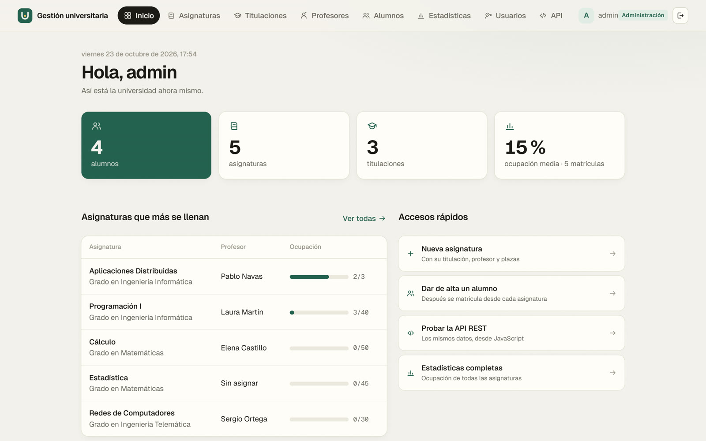
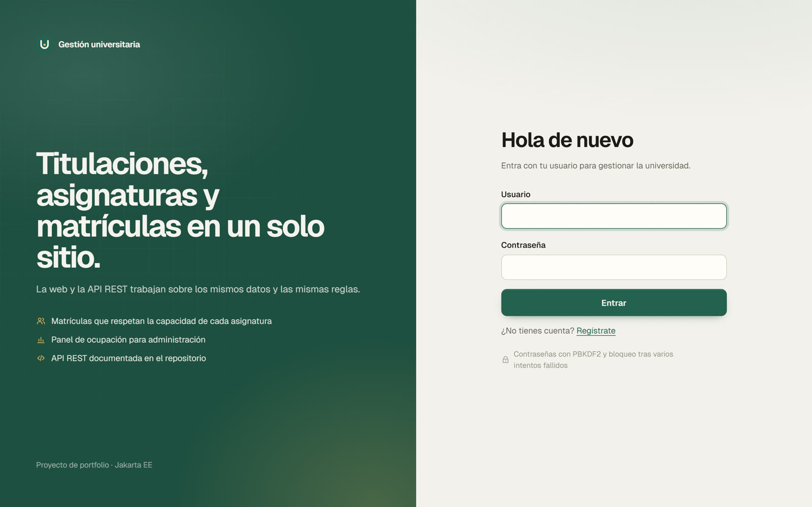
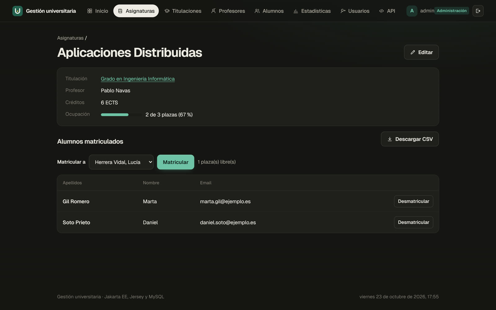
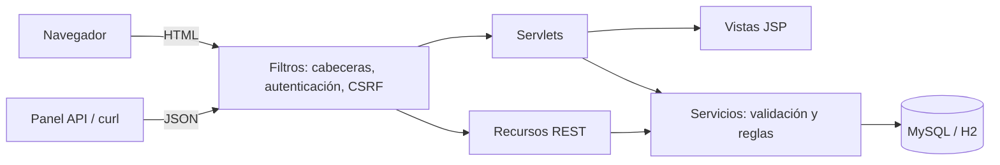
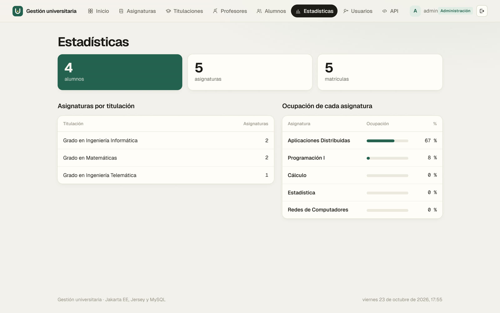

# Gestión universitaria

Aplicación web en Java (Jakarta EE) para gestionar titulaciones, asignaturas, profesores, alumnos y matrículas, con una interfaz MVC hecha con Servlets y JSP y una API REST con Jersey que trabaja sobre los mismos datos.

[](https://github.com/alejandrorevillaEng/gestion-universitaria/actions/workflows/ci.yml)
[](https://github.com/alejandrorevillaEng/gestion-universitaria/actions/workflows/seguridad.yml)
[](LICENSE)



## Por qué existe

Nació como la práctica de Desarrollo de Aplicaciones Distribuidas II (Grado en Ingeniería Informática, UCAM, curso 2025-26). La versión entregada cumplía el enunciado, pero guardaba todo en memoria, la API REST era pública y no tenía tests. Después la he rehecho para que se parezca a lo que haría en un proyecto real: base de datos, seguridad revisada a fondo, tests de integración y despliegue con Docker. También he añadido lo que el enunciado pedía para las convocatorias siguientes (alumnos, matrículas, exportar a CSV y panel de estadísticas).

## Qué hace

- Login, autorregistro y una zona de administración (gestión de usuarios y estadísticas) a la que solo entra el administrador.
- Gestión completa de titulaciones, asignaturas, profesores y alumnos.
- Asignación de un profesor a cada asignatura y matrícula de alumnos respetando la capacidad máxima.
- No deja borrar lo que dejaría datos colgando: una asignatura con alumnos, una titulación con asignaturas o un profesor que imparte clase.
- Exporta los matriculados de cada asignatura a CSV.
- Panel de estadísticas: total de alumnos, asignaturas por titulación y ocupación de cada asignatura.
- API REST con las mismas operaciones ([documentación](docs/api.md)) y una página que la usa desde JavaScript.
- Interfaz propia, sin frameworks de CSS: tipografía Geist servida desde la app, iconos SVG propios, modo oscuro automático, diseño adaptable al móvil y animaciones que se desactivan si el sistema pide reducir el movimiento.

| Acceso | Ficha de una asignatura (modo oscuro) |
|---|---|
|  |  |

## Stack y decisiones técnicas

| Pieza | Tecnología | Por qué |
|---|---|---|
| Web | Servlets 6.1 y JSP con JSTL | Es lo que pedía la asignatura (MVC sin framework). Con JSTL todo se pinta escapado y las vistas no llevan Java. |
| API | Jersey 4 (Jakarta REST) con JSON-B | La implementación de referencia de JAX-RS. Los recursos llaman a los mismos servicios que los servlets, así que las reglas de negocio están en un solo sitio. |
| Datos | JDBC con HikariCP, MySQL 8 en Docker y H2 en desarrollo | Con SQL a mano se ve cada consulta, y todas van parametrizadas. H2 en modo MySQL permite arrancar la aplicación y los tests sin instalar nada. |
| Servidor | Tomcat 11 | En producción, la imagen oficial. En desarrollo y en los tests, Tomcat embebido. |
| Tests | JUnit 6 y Tomcat embebido | Los tests de integración levantan la aplicación entera y la prueban por HTTP, filtros y JSP incluidos. |

## Arquitectura



Los servlets (`web/`) y los recursos REST (`api/`) no tienen lógica: leen la petición, llaman a un servicio (`servicio/`) y devuelven una vista o un JSON. Las reglas (capacidad, borrados, permisos sobre usuarios) y la validación están en los servicios, y cada operación va en una transacción. La matrícula bloquea la fila de la asignatura (`SELECT ... FOR UPDATE`) para que dos matrículas a la vez no ocupen la misma última plaza.

## Cómo ejecutarlo

Requisitos: Java 21. No hace falta instalar Maven ni Tomcat (en Windows, usa `mvnw.cmd` en lugar de `./mvnw`).

```bash
git clone https://github.com/alejandrorevillaEng/gestion-universitaria.git
cd gestion-universitaria
./mvnw test-compile exec:exec@dev
```

Abre http://localhost:8080 y entra con `admin` / `admin`. Arranca con una base de datos H2 en memoria y datos de ejemplo inventados.

Con MySQL y la imagen de producción (Docker):

```bash
cp .env.example .env    # pon una contraseña en DB_PASSWORD
docker compose up --build
```

El script de la base de datos está en [`src/main/resources/db/dad2.sql`](src/main/resources/db/dad2.sql). Define `ADMIN_PASSWORD` en `.env` para cambiar la contraseña del administrador.

## Tests

```bash
./mvnw verify
```

28 tests: reglas de negocio contra H2 (capacidad, matrículas concurrentes, borrados con dependencias, validación, CSV) y pruebas de integración que arrancan la aplicación en un Tomcat embebido y la atacan por HTTP. El informe de cobertura queda en `target/site/jacoco/` (alrededor del 73 % de las instrucciones).

## Seguridad

Al revisar la versión entregada encontré varios fallos. Cada uno tiene ahora un test que falla si vuelve a aparecer:

- La API REST no pedía sesión. Ahora pasa por el mismo control de acceso que la web, y la gestión de usuarios es solo para administradores.
- El filtro de login miraba `getRequestURI()` con `endsWith(".css")`, así que una URL como `/titulaciones;x.css` se lo saltaba. Ahora usa la ruta ya normalizada por el contenedor.
- XSS almacenado: las JSP pintaban los datos sin escapar y el panel REST usaba `innerHTML`. Ahora todo pasa por JSTL o `textContent`, y una Content-Security-Policy sin scripts en línea hace de segunda barrera.
- Las contraseñas se guardaban en claro. Ahora van con PBKDF2-SHA256 (600.000 iteraciones), y el login se bloquea un rato tras varios fallos seguidos.
- Los borrados se hacían por GET y sin protección CSRF. Ahora van por POST con token, la cookie de sesión es HttpOnly y SameSite, y al entrar se genera un id de sesión nuevo.
- Un registro sin nombre podía romper el login de todos los usuarios (un `NullPointerException`). Ahora se valida la entrada y los errores devuelven 400 o 409 con una página propia, nunca una traza de Java.

En cada cambio se ejecutan gitleaks, semgrep y osv-scanner. Para informar de una vulnerabilidad: [SECURITY.md](SECURITY.md).



## Próximos pasos

- Aulas y su relación con las asignaturas, que es lo que el enunciado deja para la convocatoria especial.
- Paginación y búsqueda en los listados.
- Especificación OpenAPI generada a partir de los recursos.

## Autor

Alejandro Revilla Blanco

## Licencia

[MIT](LICENSE)
