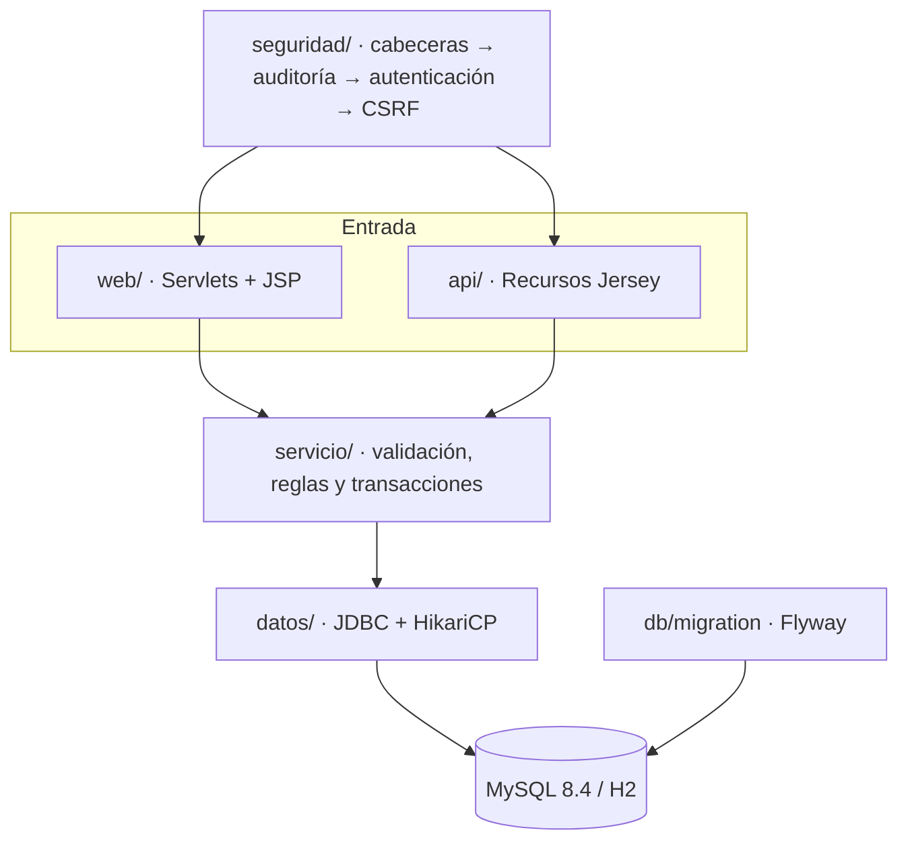

# Arquitectura

## Capas

| Paquete | Responsabilidad | Lo que no hace |
|---|---|---|
| `seguridad` | Filtros de la petición, hash de contraseñas, límite de intentos | No conoce los servicios |
| `web` | Leer parámetros, llamar a un servicio, elegir vista o redirección | Nada de SQL ni de reglas |
| `api` | Lo mismo que `web`, pero con JSON | Idem |
| `servicio` | Validar, aplicar reglas y abrir la transacción | No sabe si la llamada viene de la web o de la API |
| `datos` | Conexiones, transacciones y utilidades JDBC | Nada de negocio |
| `modelo` | Clases de datos | Sin lógica, salvo derivados como `plazasLibres` |

Una petición que cambia datos recorre los filtros en este orden, definido en `web.xml`:

1. `FiltroCabeceras`: CSP, `X-Frame-Options`, `nosniff` y HSTS si va por HTTPS.
2. `FiltroAuditoria`: anota el cambio al terminar, con el estado de la respuesta.
3. `FiltroAutenticacion`: sin sesión, redirige al login (web) o responde 401 (API). Comprueba el rol en las rutas de administración.
4. `FiltroCsrf`: compara el token del formulario o de la cabecera `X-CSRF-Token` con el de la sesión.

## Decisiones

Cada decisión con su contexto y lo que se pierde al tomarla. Están en el orden en que se tomaron.

### 1. MVC con Servlets y JSP, sin framework

- Contexto: es lo que pide la asignatura y el objetivo era entender qué hace un framework por debajo.
- Decisión: un servlet por entidad, con un parámetro `accion`, y vistas JSP con JSTL. Una clase base (`ControladorBase`) reúne lo repetido: leer ids, avisos y redirecciones.
- Consecuencias: más código que con Spring MVC, pero sin magia. Todo lo que se pinta va escapado por JSTL, así que las vistas no llevan Java.

### 2. La web y la API comparten servicios

- Contexto: la entrega original duplicaba la lógica entre servlets y recursos REST, y no siempre coincidía.
- Decisión: un único objeto `Servicios` en el `ServletContext`, que usan los dos.
- Consecuencias: una regla (por ejemplo, la capacidad de un aula) se escribe y se prueba una vez. Los tests de servicio cubren las dos entradas.

### 3. JDBC a mano en lugar de JPA

- Contexto: el modelo es pequeño y las consultas interesantes (ocupación, búsqueda, bloqueo de la matrícula) se leen mejor en SQL.
- Decisión: JDBC con HikariCP y una utilidad mínima (`Jdbc`) para listas, uno, enteros e inserciones. Todas las consultas van parametrizadas.
- Consecuencias: hay que mapear a mano, pero cada consulta se ve tal cual. Sin un ORM no hay consultas N+1 escondidas.

### 4. Matrícula con `SELECT ... FOR UPDATE`

- Contexto: dos matrículas a la vez podían ocupar la misma última plaza.
- Decisión: la transacción bloquea la fila de la asignatura antes de contar las plazas.
- Consecuencias: las matrículas de una misma asignatura se serializan, que es justo lo que se quiere. Lo comprueba un test con ocho hilos, contra H2 y contra MySQL.

### 5. H2 en modo MySQL para desarrollo y tests, MySQL real en CI

- Contexto: quien clone el repo debe poder arrancarlo sin instalar nada, pero H2 no se comporta exactamente igual que MySQL. Por ejemplo, tratan distinto la barra invertida en `LIKE ... ESCAPE`.
- Decisión: H2 por defecto. Un job de CI ejecuta con Testcontainers los tests que dependen del motor contra MySQL 8.4, y otro levanta la imagen de producción con Docker Compose.
- Consecuencias: el arranque local no cuesta nada y las diferencias entre motores las detecta la CI. La búsqueda escapa con `!` en vez de `\` porque se comporta igual en los dos.

### 6. Flyway para el esquema

- Contexto: el esquema estaba en un script que había que ejecutar a mano y no había forma de evolucionarlo sin borrar datos.
- Decisión: migraciones versionadas en `src/main/resources/db/migration`, aplicadas al arrancar.
- Consecuencias: añadir aulas fue una migración `V2` que se aplica sola sobre una base de datos existente.

### 7. Sesión y CSRF también para la API

- Contexto: la API original era pública. Un token JWT habría sido otra forma de autenticación que mantener.
- Decisión: la API usa la misma sesión que la web. `POST /api/sesion` devuelve el token CSRF para clientes como curl o Postman.
- Consecuencias: un único modelo de seguridad y sin secretos de firma que gestionar. A cambio, la API no es cómoda para clientes sin cookies; si hiciera falta, el siguiente paso serían tokens de acceso.

### 8. Listados: arrays de siempre y total en cabecera

- Contexto: la paginación no podía romper a los clientes que ya leían un array (el panel de la API).
- Decisión: sin parámetros, la respuesta es igual que antes. Con `q`, `pagina` o `tam`, se devuelve el trozo pedido y el total va en `X-Total-Count`.
- Consecuencias: compatibilidad hacia atrás sin versionar la API.

### 9. OpenAPI escrito a mano y comprobado por un test

- Contexto: generar la especificación con anotaciones de Swagger habría llenado los recursos de metadatos y añadido una dependencia en producción.
- Decisión: `docs/openapi.yaml` escrito a mano. `ContratoApiTest` compara sus rutas y verbos con los de los recursos registrados.
- Consecuencias: la documentación está separada del código, pero si alguien añade un endpoint sin documentarlo, la build falla.

## Operación

- Configuración por variables de entorno: `DB_URL`, `DB_USER`, `DB_PASSWORD`, `ADMIN_PASSWORD` y `DATOS_EJEMPLO`. Con MySQL, `ADMIN_PASSWORD` es obligatoria.
- `GET /api/salud` responde 200 si la aplicación llega a la base de datos. La imagen Docker la usa como `HEALTHCHECK`.
- El logger `auditoria` deja una línea por cada cambio: `usuario=… metodo=… ruta=… estado=… ip=…`. Detrás de un proxy, la IP y el esquema salen de `X-Forwarded-For` y `X-Forwarded-Proto` (`RemoteIpValve` en `context.xml`).
- Al subir una etiqueta `vX.Y.Z` se publican el WAR, con su SHA-256, y la imagen en GitHub Packages.
